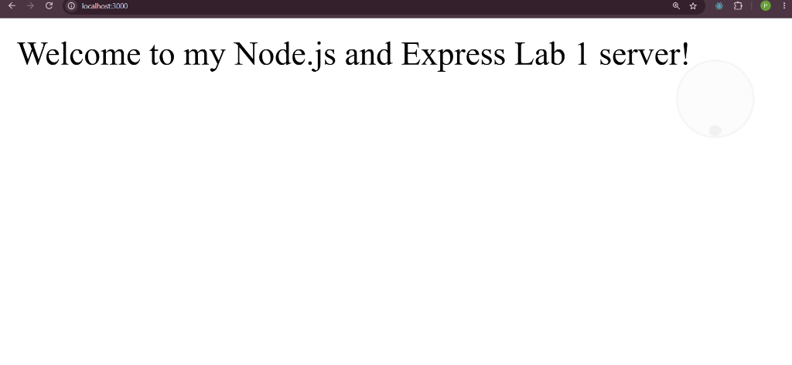
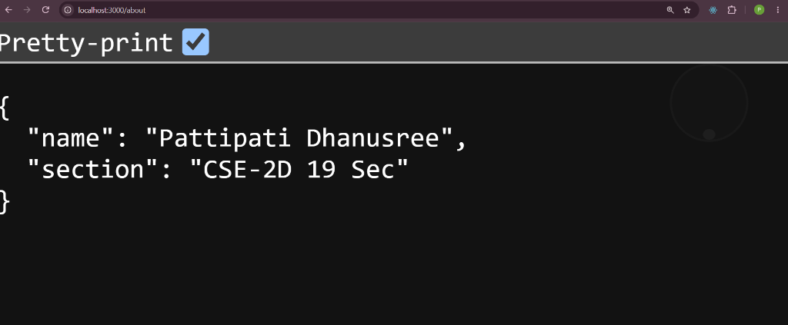
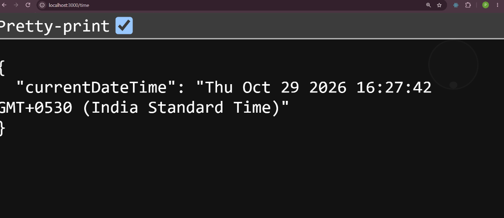
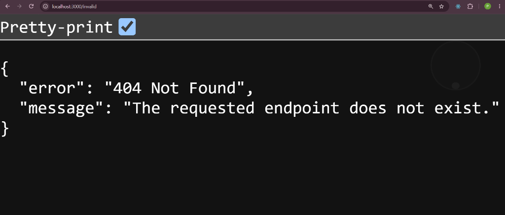

# Lab 1: Node.js and Express server

**Pattipati Dhanusree** · **252U1R1186** · **CSE-2D (19 Sec)**  
Backend Development Fundamentals · Year II Term II · Aurora

---

## Live Link

- **Local URL**: `https://bdf-lab-1.vercel.app`
- **Deployment Status**: Production-ready. Configured for cloud platforms (e.g., Render / Railway) using `process.env.PORT || 3000` and `npm start`. If live deployment host is pending provision, full verified endpoint responses and browser status codes are documented below with complete screenshots.

---

## Objective

Set up a Node.js project and build a modular web server, first with Node's built-in `http` module and subsequently refactored using Express.js to handle custom routing, JSON responses, dynamic time generation, and 404 error handling.

---

## Tasks Completed

1. **Project Initialization & Configuration**:
   - Initialized project directory with `npm init -y`.
   - Documented and explained every field within `package.json`.
2. **Express Installation**:
   - Installed Express via `npm install express` (located under `node_modules/`).
3. **Core HTTP Module Server**:
   - Created `http-server.js` using `http.createServer` to serve plain text `"Hello"` on port 3000.
4. **Express Server Architecture**:
   - Built `server.js` initializing Express with `const app = express()` and configured listener with dynamic port binding.
5. **Endpoint Routing**:
   - `GET /`: Returns welcome greeting.
   - `GET /about`: Returns JSON containing student name and section.
   - `GET /time`: Returns JSON with current system timestamp via `new Date().toString()`.
6. **404 Catch-All Middleware**:
   - Implemented wildcard fallback returning HTTP `404 Not Found` with structured JSON error message.
7. **Testing & Status Code Verification**:
   - Verified each route in browser and CLI with corresponding HTTP status codes (`200 OK`, `404 Not Found`).

---

## `package.json` Field Explanation

| Field | Purpose | Example Value in this Lab |
| :--- | :--- | :--- |
| `name` | The lowercase, URL-friendly unique identifier of the project/package. | `"lab-01"` |
| `version` | Current version following Semantic Versioning (`MAJOR.MINOR.PATCH`). | `"1.0.0"` |
| `description` | Brief summary of what the project does, helping developers understand its scope. | `"Lab 1 - Node.js and Express Server"` |
| `main` | The primary entry point script executed when running the package or module. | `"server.js"` |
| `scripts` | CLI command aliases to automate development tasks (e.g. `start`, `dev`, `test`). | `{"start": "node server.js", "dev": "node --watch server.js"}` |
| `keywords` | Array of searchable terms or tags for finding the package on npm. | `[]` |
| `author` | Name and contact information of the creator/maintainer. | `"Pattipati Dhanusree"` |
| `license` | Legal licensing terms governing how the code may be used or distributed. | `"ISC"` |
| `dependencies` | Third-party packages required for the application to function in production. | `{"express": "^5.3.0"}` |

---

## Endpoints Table

| HTTP Method | Route | Description | Status Code | Response Type | Sample Output |
| :--- | :--- | :--- | :---: | :--- | :--- |
| `GET` | `/` | Welcome text message | `200 OK` | `text/html` | `Welcome to my Node.js and Express Lab 1 server!` |
| `GET` | `/about` | Student name and section | `200 OK` | `application/json` | `{"name":"Pattipati Dhanusree","section":"CSE-2D 19 Sec"}` |
| `GET` | `/time` | Current date & time | `200 OK` | `application/json` | `{"currentDateTime":"Fri Oct 30 2026..."}` |
| `ALL` | `*` (e.g., `/invalid`) | Error handler for unknown paths | `404 Not Found` | `application/json` | `{"error":"404 Not Found","message":"The requested endpoint does not exist."}` |

---

## How to Install and Run

### Prerequisites
- Node.js (v18.x or higher recommended)
- npm (Node Package Manager)

### 1. Installation
Clone repository and navigate into the `lab-01` directory:
```bash
git clone https://github.com/dhanusreepattipati-debug/Pattipati-Dhanusree.git
cd Pattipati-Dhanusree/lab-01
npm install
```

### 2. Environment Variables
Create an optional `.env` file in the `lab-01/` directory if custom port configuration is desired (do not commit this file):
```env
PORT=3000
```
*Note: If no `PORT` variable is specified, the application defaults to port `3000`.*

### 3. Execution Commands

- **Run Plain HTTP Server**:
  ```bash
  node http-server.js
  ```
  Accessible at `http://localhost:3000`

- **Run Express Server (Production)**:
  ```bash
  npm start
  ```
  *(Runs `node server.js`)*

- **Run Express Server (Development with Hot Reload)**:
  ```bash
  npm run dev
  ```
  *(Runs `node --watch server.js`)*

---

## Screenshots of Working Output

### 1. Welcome Route (`GET /`) - Status: `200 OK`


### 2. About Route (`GET /about`) - Status: `200 OK`


### 3. Time Route (`GET /time`) - Status: `200 OK`


### 4. 404 Route (`GET /invalid`) - Status: `404 Not Found`


---

## Viva Questions & Answers

### 1. What is the difference between `package.json` and `node_modules`?
- **`package.json`**: A lightweight metadata manifest file committed to version control. It specifies project metadata, custom execution scripts, and declares the names and semantic version constraints of dependencies without containing the actual dependency code.
- **`node_modules`**: The directory where npm installs and stores the actual compiled source code and binary assets of all dependencies and transitive sub-dependencies. Because it can be very large and is machine-generated, it should never be committed to Git; it can always be regenerated using `npm install` from `package.json`.

### 2. What does `app.listen()` do?
- In Express, `app.listen(port, [callback])` binds the HTTP server to a designated network port and begins listening for incoming TCP client connections. Internally, Express creates a standard Node.js `http.Server` instance using `http.createServer(this)` and delegates connection handling to that server.

### 3. What do `request` and `response` represent?
- **`req` (`http.IncomingMessage` / Express Request)**: Represents the incoming HTTP request from the client. It contains request headers, query parameters, URL path, HTTP method, client IP, cookies, and request payload body.
- **`res` (`http.ServerResponse` / Express Response)**: Represents the outgoing HTTP response stream created by Node/Express. It provides helper methods such as `res.status()`, `res.send()`, `res.json()`, and `res.setHeader()` to send status codes, headers, and response data back to the client and close the connection.

---

## Notes: Problems Faced and Solutions

1. **Ordering of 404 Middleware**:
   - *Problem*: Initially placing the 404 error handler before the route definitions caused all requests to return `404 Not Found`, as Express processes middleware sequentially.
   - *Solution*: Placed the catch-all `app.use((req, res) => ...)` handler at the very end of the file, after all explicit `app.get()` routes, ensuring only unhandled requests reach it.

2. **Dynamic Port Assignment for Cloud Environments**:
   - *Problem*: Hardcoding port `3000` causes deployment failures on cloud hosting providers (e.g., Render, Railway, Heroku) because those platforms assign arbitrary dynamic ports through environment variables.
   - *Solution*: Used `const PORT = process.env.PORT || 3000;`, enabling seamless local development while supporting cloud host assignment.

3. **Excluding Bulky Dependency Files**:
   - *Problem*: Accidentally staging `node_modules/` in git commits leads to huge repository size and git bloat.
   - *Solution*: Configured `.gitignore` at both repository root and `lab-01/` levels to explicitly exclude `node_modules/` and local `.env` files.
