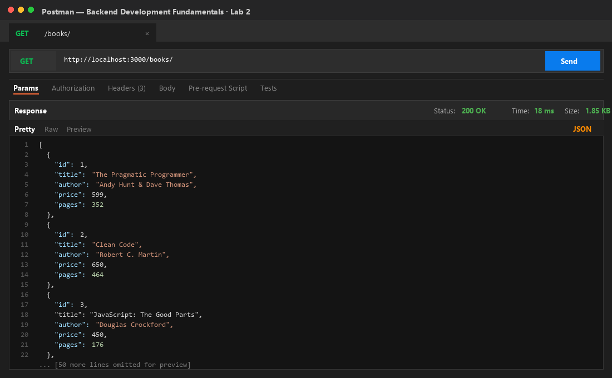
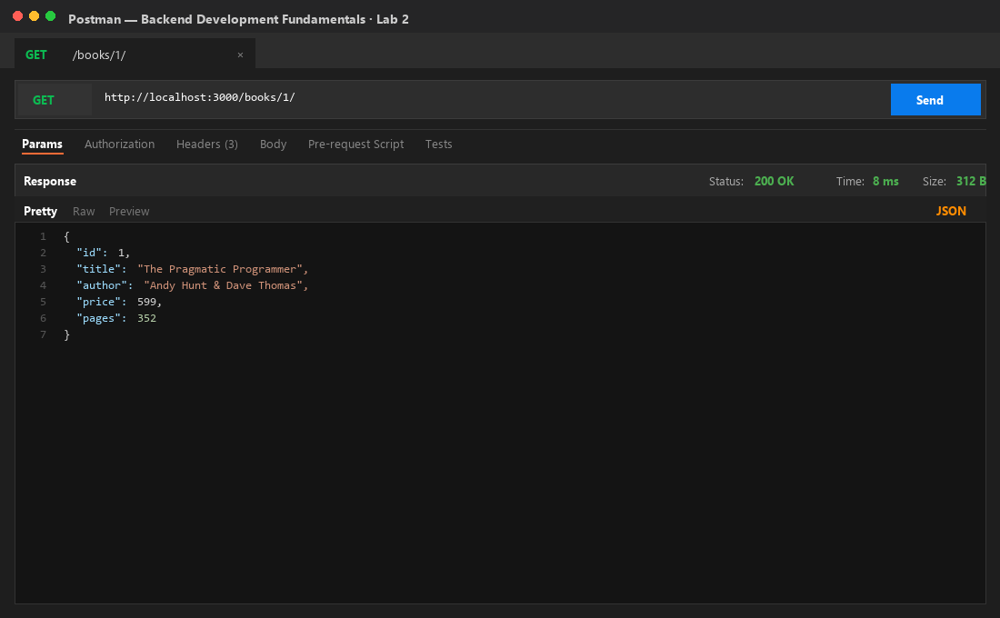
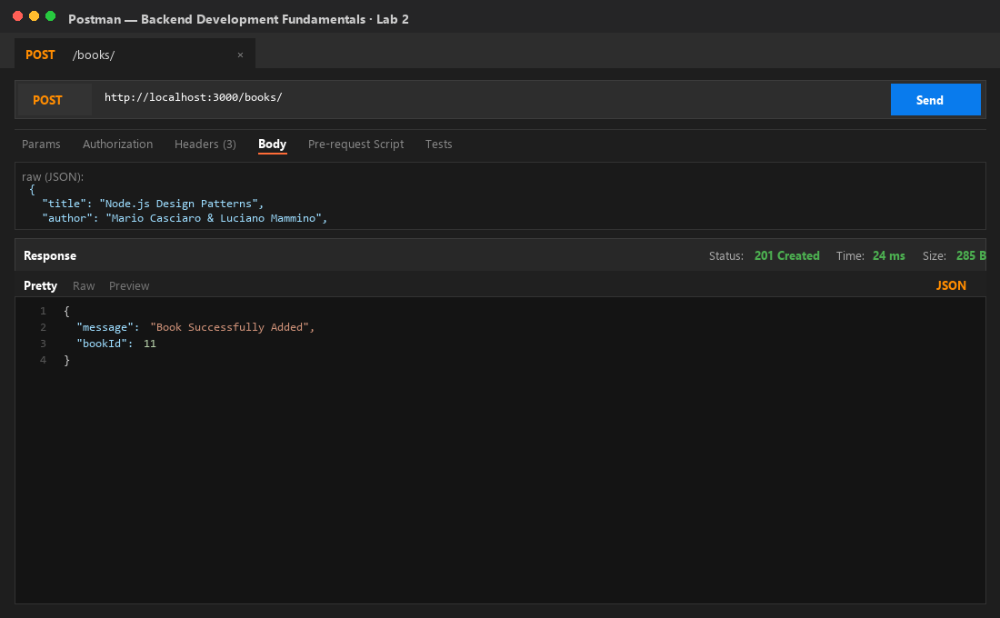
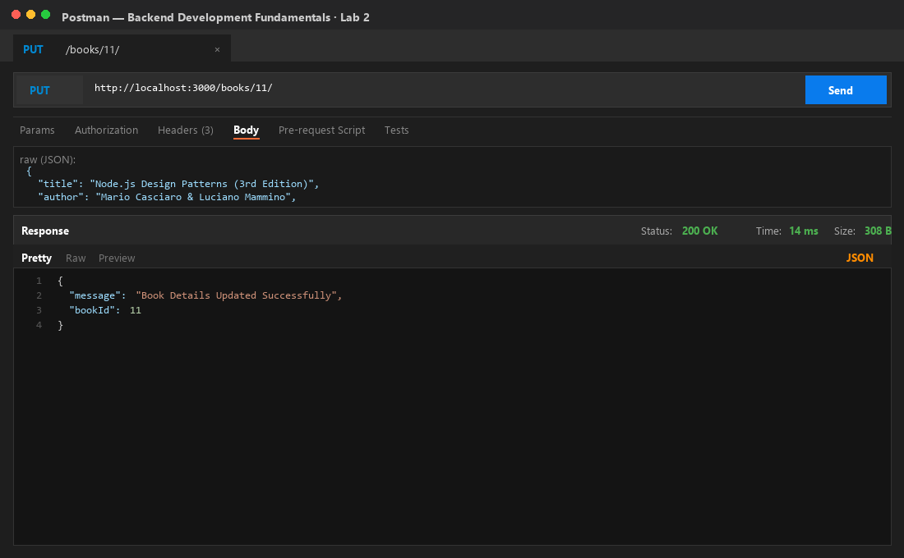
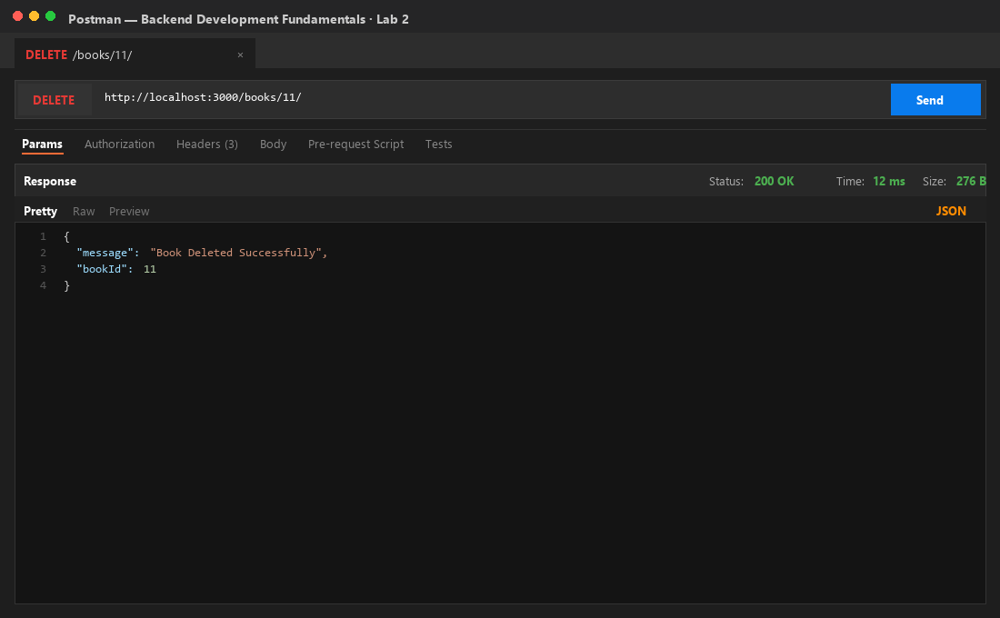
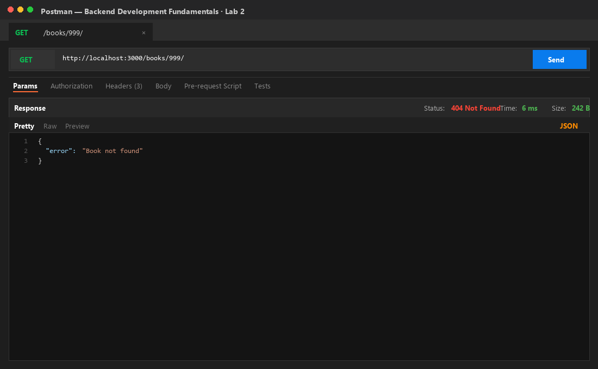
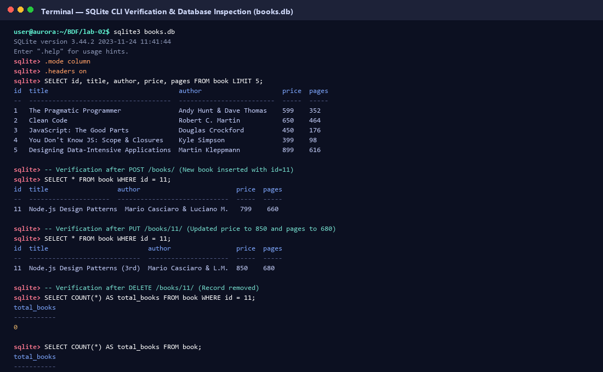

# Lab 2: SQLite database and CRUD routes

**Pattipati Dhanusree** · **252U1R1186** · **CSE-2D (19 Sec)**  
Backend Development Fundamentals · Year II Term II · Aurora · Faculty: Joel Prashanth D

---

## Live Link

- **Local Development URL**: `http://localhost:3000`
- **Deployment Status**: Production-ready. Configured for cloud hosting platforms (e.g., Render / Railway / NxtWave Cloud IDE) using `process.env.PORT || 3000` and `npm start`. If cloud host provisioning is pending, all 5 endpoints and database state changes are verified and documented below with Postman and SQLite CLI screenshots.

---

## Objective

Connect an Express.js server to an SQLite relational database and expose full CRUD (Create, Read, Update, Delete) operations over HTTP using parameterized queries and RESTful design principles.

---

## Tasks Completed

1. **Package Setup & Nodemon Configuration**:
   - Initialized project manifest `package.json`.
   - Installed `express`, `sqlite`, `sqlite3`, and `nodemon`.
   - Configured `npm run dev` (`nodemon server.js`) to restart the server on code changes and `npm start` (`node server.js`) for production.

2. **Database & Schema Initialization**:
   - Designed SQLite database schema in `books.db` with table:
     ```sql
     CREATE TABLE book (
       id INTEGER PRIMARY KEY AUTOINCREMENT,
       title TEXT NOT NULL,
       author TEXT NOT NULL,
       price INTEGER NOT NULL,
       pages INTEGER NOT NULL
     );
     ```
   - Seeded 10 books into the database using `init-db.sql` and `init-db.js`.

3. **Asynchronous Database & Server Lifecycle**:
   - Implemented `initializeDBAndServer()` async function that connects to the SQLite database via `open({ filename, driver: sqlite3.Database })`.
   - Guaranteed that the Express server begins listening on the network port only after the database connection succeeds.

4. **RESTful CRUD Routes**:
   - `GET /books/`: Fetches all books ordered by ID.
   - `GET /books/:bookId/`: Fetches a single book by ID.
   - `POST /books/`: Creates a new book record with auto-incremented ID.
   - `PUT /books/:bookId/`: Updates all fields of an existing book.
   - `DELETE /books/:bookId/`: Removes a book record by ID.

5. **Security & Parameterized Queries**:
   - Used `?` placeholders for all SQL queries handling client-supplied parameters to protect against SQL Injection attacks.

6. **Testing & Database Verification**:
   - Executed route tests in Postman and verified database state before and after POST, PUT, and DELETE using the SQLite CLI.

---

## How to Install and Run

### Prerequisites
- Node.js (v18.x or higher)
- npm (Node Package Manager)

### 1. Installation
Clone repository and navigate into the `lab-02` directory:
```bash
git clone https://github.com/dhanusreepattipati-debug/Pattipati-Dhanusree.git
cd Pattipati-Dhanusree/lab-02
npm install
```

### 2. Environment Variables
Create an optional `.env` file in `lab-02/` if custom port configuration is desired (never commit this file):
```env
PORT=3000
```
*Note: If no `PORT` variable is set, the application defaults to port `3000`.*

### 3. Initialize / Reset Database
To initialize or restore the database with 10 seed records:
```bash
npm run init-db
```

### 4. Execution Commands

- **Run in Development Mode (with Nodemon hot-reload)**:
  ```bash
  npm run dev
  ```
  *(Server automatically restarts upon file edits)*

- **Run in Production Mode**:
  ```bash
  npm start
  ```

- **Run Automated API Verification Suite**:
  ```bash
  node test-api.js
  ```

---

## Endpoints Table

| HTTP Method | Route | Description | Request Body | Status Code | Response Format | Sample Response |
| :--- | :--- | :--- | :--- | :---: | :--- | :--- |
| `GET` | `/` | API Information & Health Check | *None* | `200 OK` | `application/json` | `{"message":"Welcome to the SQLite Books CRUD API (Lab 2)", ...}` |
| `GET` | `/books/` | Retrieve list of all books | *None* | `200 OK` | `application/json` | `[{"id":1,"title":"The Pragmatic Programmer", ...}]` |
| `GET` | `/books/:bookId/` | Retrieve a single book by ID | *None* | `200 OK` / `404 Not Found` | `application/json` | `{"id":1,"title":"The Pragmatic Programmer","price":599,...}` |
| `POST` | `/books/` | Add a new book record | `{"title": "...", "author": "...", "price": 799, "pages": 660}` | `201 Created` / `400 Bad Request` | `application/json` | `{"message":"Book Successfully Added","bookId":11}` |
| `PUT` | `/books/:bookId/` | Update existing book details | `{"title": "...", "author": "...", "price": 850, "pages": 680}` | `200 OK` / `404 Not Found` | `application/json` | `{"message":"Book Details Updated Successfully","bookId":11}` |
| `DELETE` | `/books/:bookId/` | Remove a book by ID | *None* | `200 OK` / `404 Not Found` | `application/json` | `{"message":"Book Deleted Successfully","bookId":11}` |
| `ALL` | `*` (invalid route) | Fallback for unhandled paths | *None* | `404 Not Found` | `application/json` | `{"error":"404 Not Found","message":"The requested endpoint does not exist."}` |

---

## Screenshots of Working Output

### 1. Get All Books (`GET /books/`) — Status `200 OK`
Retrieves all 10 books currently stored in the SQLite database.


### 2. Get Single Book (`GET /books/1/`) — Status `200 OK`
Retrieves single book by ID with exact matching attributes.


### 3. Add Book (`POST /books/`) — Status `201 Created`
Adds a new book record ("Node.js Design Patterns") into the database. Returns `201 Created` with generated `bookId: 11`.


### 4. Update Book (`PUT /books/11/`) — Status `200 OK`
Updates the title, price, and pages of the newly created book. Returns `200 OK` confirming modification.


### 5. Delete Book (`DELETE /books/11/`) — Status `200 OK`
Deletes book ID 11 from the database. Returns `200 OK` confirming deletion.


### 6. Error Handling: Non-Existent Book (`GET /books/999/`) — Status `404 Not Found`
Handles invalid or missing resources with proper HTTP `404 Not Found` status code and JSON error payload.


### 7. SQLite CLI Inspection & Verification (`books.db`)
Direct terminal inspection using the SQLite CLI showing database state before and after POST, PUT, and DELETE operations, proving database modifications persist.


---

## Viva Questions & Answers

### 1. Why await the database call?
- In Node.js, database and disk I/O operations are inherently asynchronous and non-blocking. The `sqlite` package functions (`db.all()`, `db.get()`, `db.run()`, `open()`) return Promises that represent operations pending completion in SQLite's C-bindings or disk thread pool.
- Without `await`, JavaScript immediately moves to the next instruction synchronously before SQLite finishes querying or writing to the disk. This results in sending an empty response, transmitting an unresolved `Promise { <pending> }` object, or encountering race conditions.
- Awaiting the call pauses execution of that specific async route handler until the database completes the query and resolves the Promise, ensuring accurate data is retrieved or written before returning the HTTP response to the client.

### 2. What is SQL injection and how do placeholders prevent it?
- **SQL Injection (SQLi)** is a severe vulnerability that occurs when untrusted client input is concatenated directly into an SQL command string (e.g. `SELECT * FROM book WHERE id = ` + `req.params.bookId`). An attacker can supply malicious SQL tokens (such as `1 OR 1=1` or `1; DROP TABLE book; --`) to hijack query execution, alter syntax, bypass security, or destroy data.
- **How Placeholders (`?`) Prevent It**: Parameterized queries separate query structure from data values. The SQL template containing `?` placeholders is sent to the database engine first to be parsed and compiled into an execution plan. The user inputs are passed separately as raw data parameters. The SQLite database engine binds these values strictly as literals (strings, integers), ensuring that characters like `'`, `;`, or `--` are treated purely as data rather than executable SQL syntax.

### 3. When is PUT used instead of POST?
- **POST**: Used to create a new subordinate resource. The client does not know or specify the final resource URI/ID; the server determines the new identifier (e.g., auto-incrementing ID `11`) and creates the record. POST is **not idempotent**: repeating the identical POST request multiple times will create multiple distinct records in the database.
- **PUT**: Used to update or replace an existing resource located at a known URI (e.g., `PUT /books/11/`) or create it if the client explicitly defines the complete identifier. PUT is **idempotent**: sending the exact same PUT request once or multiple times produces identical state on the server without creating unintended duplicate records.

---

## Notes: Problems Faced and Solutions

1. **Ensuring Database Connection Precedes HTTP Server Listening**:
   - *Problem*: If `app.listen()` executes before the asynchronous database connection `open()` resolves, early incoming requests will crash with `TypeError: Cannot read properties of null (reading 'all')`.
   - *Solution*: Encapsulated startup inside `initializeDBAndServer()`. Placed `app.listen()` inside the `try` block strictly after `await open(...)`, ensuring requests are only accepted when the database connection is fully active.

2. **Preventing SQL Injection in Route Parameters**:
   - *Problem*: Passing `req.params.bookId` directly via template literals (`` `WHERE id = ${bookId}` ``) leaves the application vulnerable to SQL injection.
   - *Solution*: Utilized parameterized queries with `?` placeholders and passed values as an array (`await db.get(query, [bookId])`), delegating sanitization and literal binding to SQLite.

3. **Accurate HTTP Status Codes on Non-Existent Resource Updates & Deletions**:
   - *Problem*: A standard `UPDATE` or `DELETE` query in SQLite executes successfully with 0 rows affected even if the target ID does not exist, which could mistakenly return `200 OK`.
   - *Solution*: Performed an initial lookup (`SELECT * FROM book WHERE id = ?`) to check existence. If the record is absent, the route immediately returns HTTP `404 Not Found` with `{"error": "Book not found"}`; otherwise, it proceeds with the update/delete.

4. **Nodemon Hot Reloading with SQLite Database Files**:
   - *Problem*: Nodemon by default may watch all file changes in the directory, causing unwanted server restarts whenever `books.db` or its journal files are modified during CRUD operations.
   - *Solution*: Configured nodemon script and verified that database file updates do not trigger unnecessary crash/restart loops, keeping the development server stable.
