# Lab 3: REST API, query parameters, validation, debugging

**Pattipati Dhanusree** · **252U1R1186** · **CSE-2D (19 Sec)**  
Backend Development Fundamentals · Year II Term II · Aurora ·

---

## Objective

Turn the Lab 2 routes into a clean REST API with search, sorting, validation, correct status codes, and practise debugging common errors.
LIVE LINK : https://bdf-lab3.vercel.app

---

## Tasks Completed

1. **RESTful Noun-Based Endpoints & HTTP Verbs**:
   - Refactored routes to strictly follow noun-based REST conventions (`/books`, `/books/:id`).
   - Mapped HTTP verbs to standard CRUD actions: `GET` (retrieve), `POST` (create), `PUT` (update), and `DELETE` (remove).

2. **Query Parameters for Search, Sort, and Pagination**:
   - Added query parameter handling to `GET /books`:
     - `search_q`: Partial title match implemented using SQL `LIKE ?` with `%search_q%` wildcards (defaults to empty string).
     - `order_by`: Sorting column validated against an allowed whitelist `["id", "title", "author", "price"]` (defaults to `id`).
     - `order`: Sort order (`ASC` or `DESC`, case-insensitive, defaults to `ASC`).
     - `limit` and `offset`: Integer-based pagination controls (defaulting to `10` and `0` respectively).

3. **Price Range Filtering**:
   - Implemented `min_price` and `max_price` query parameters using parameterized comparisons (`price >= ?` and `price <= ?`).
   - Validated that values are finite numbers and that `min_price` does not exceed `max_price`.

4. **Request Body Validation**:
   - Added strict validation on `POST /books` and `PUT /books/:id`:
     - Requires non-empty string for `title` and `author`.
     - Requires numeric, non-negative finite value for `price`.
   - Rejects invalid or missing inputs with HTTP `400 Bad Request` and clear descriptive JSON error messages.

5. **Accurate HTTP Status Codes**:
   - `201 Created`: Returned upon successfully adding a new book via `POST`.
   - `200 OK`: Returned for successful retrieval, update, or deletion.
   - `400 Bad Request`: Returned when query parameters or body attributes fail validation.
   - `404 Not Found`: Returned when attempting to fetch, update, or delete a non-existent `id`.
   - `500 Internal Server Error`: Returned inside a guarded `try/catch` block for unexpected server-side failures.

6. **Consistent JSON Response Format**:
   - Unified all feedback messages to follow standard object structures, such as `{ "message": "..." }` for status acknowledgments and validation errors.

7. **Debugging Exercise (Faculty Broken Version)**:
   - Diagnosed and resolved 4 bugs distributed in the faculty version:
     1. Port Conflict (`EADDRINUSE`): Resolved by checking active process bindings and configuring dynamic port fallback `process.env.PORT || 3000`.
     2. Wrong Import Path: Fixed faulty module path (`./databse` → `./database`).
     3. Table Name Typo: Fixed SQL query typo referencing `book` instead of `books`.
     4. Missing Await: Added `await` before asynchronous database calls (`initializeDB`, `db.all`, `db.get`, `db.run`).

---

## How to Install and Run

### Prerequisites
- Node.js (v18.x or higher)
- npm (Node Package Manager)

### 1. Installation
Clone repository and navigate into the `lab-03` directory:
```bash
git clone https://github.com/dhanusreepattipati-debug/Pattipati-Dhanusree.git
cd Pattipati-Dhanusree/lab-03
npm install
```

### 2. Running the Server

- **Run in Development Mode (with Nodemon)**:
  ```bash
  npm run dev
  ```

- **Run in Production Mode**:
  ```bash
  npm start
  ```

- **Run Automated Test Verification Suite**:
  ```bash
  npm test
  ```
  *(Executes 14 automated test assertions covering success and failure paths)*

---

## REST API Endpoints Specification

| HTTP Method | Route | Description | Query / Body Parameters | Success Status | Failure Status | Sample JSON Response |
| :--- | :--- | :--- | :--- | :---: | :---: | :--- |
| `GET` | `/books` | Retrieve books with optional search, sorting, price filter & pagination | `search_q`, `order_by`, `order`, `limit`, `offset`, `min_price`, `max_price` | `200 OK` | `400 Bad Request` | `[{"id":2,"title":"JavaScript Basics","author":"John","price":500}]` |
| `GET` | `/books/:id` | Retrieve single book by primary key ID | *None* | `200 OK` | `404 Not Found` | `{"id":2,"title":"JavaScript Basics","author":"John","price":500}` |
| `POST` | `/books` | Create a new book record | Body: `{"title": "...", "author": "...", "price": 500}` | `201 Created` | `400 Bad Request` | `{"message":"Book created successfully","book_id":7}` |
| `PUT` | `/books/:id` | Update an existing book record | Body: `{"title": "...", "author": "...", "price": 800}` | `200 OK` | `400 / 404` | `{"message":"Book updated successfully"}` |
| `DELETE` | `/books/:id` | Remove a book record by ID | *None* | `200 OK` | `404 Not Found` | `{"message":"Book deleted successfully"}` |

---

## Postman & REST Client Test List

The test suite in `requests.http` and `postman_collection.json` covers 20 test cases across 12 distinct sections:

1. **GET All Books**:
   - `GET /books` → 200 OK (returns array of books)
2. **POST Create Books**:
   - `POST /books` (JavaScript Basics, John, 500) → 201 Created (`book_id: 7`)
   - `POST /books` (Node.js Guide, David, 700) → 201 Created (`book_id: 8`)
   - `POST /books` (Python Programming, Smith, 400) → 201 Created (`book_id: 9`)
3. **GET Book By ID**:
   - `GET /books/2` → 200 OK (returns book object)
4. **404 Resource Not Found**:
   - `GET /books/9999` → 404 Not Found (`{"message": "Book not found"}`)
   - `PUT /books/9999` → 404 Not Found (`{"message": "Book not found"}`)
   - `DELETE /books/9999` → 404 Not Found (`{"message": "Book not found"}`)
5. **PUT Update Book**:
   - `PUT /books/2` with valid JSON → 200 OK (`{"message": "Book updated successfully"}`)
   - `GET /books/2` → 200 OK (verifies updated data)
6. **DELETE Book**:
   - `DELETE /books/2` → 200 OK (`{"message": "Book deleted successfully"}`)
   - `GET /books/2` → 404 Not Found (verifies record was removed)
7. **Search Books (LIKE)**:
   - `GET /books?search_q=Node` → 200 OK (returns Node.js Guide)
   - `GET /books?search_q=Python` → 200 OK (returns Python Programming)
   - `GET /books?search_q=Angular` → 200 OK (returns empty array `[]`)
8. **Sorting**:
   - `GET /books?order_by=price&order=ASC` → 200 OK (ascending order)
   - `GET /books?order_by=price&order=DESC` → 200 OK (descending order)
   - `GET /books?order_by=password` → 400 Bad Request (`{"message": "Invalid order_by column"}`)
9. **Price Filtering**:
   - `GET /books?min_price=450&max_price=750` → 200 OK (books within price range)
   - `GET /books?min_price=900&max_price=200` → 400 Bad Request (`{"message": "min_price cannot exceed max_price"}`)
10. **Pagination**:
    - `GET /books?limit=2&offset=0` → 200 OK (first 2 records)
    - `GET /books?limit=2&offset=2` → 200 OK (next 2 records)
    - `GET /books?limit=-5` → 400 Bad Request (`{"message": "Invalid limit or offset"}`)
11. **Combined Query Parameters**:
    - `GET /books?search_q=Java&order_by=price&order=ASC&min_price=200&max_price=1000&limit=5&offset=0` → 200 OK
12. **POST Validation Failures**:
    - Missing title → 400 Bad Request
    - Missing author → 400 Bad Request
    - Missing price → 400 Bad Request
    - Non-numeric price string (`"abc"`) → 400 Bad Request
    - Negative price (`-100`) → 400 Bad Request

---

## Testing Evidence & Screenshots

### 1. GET All Books (`GET /books`) — Status `200 OK`
Retrieves initial collection of books in the database.
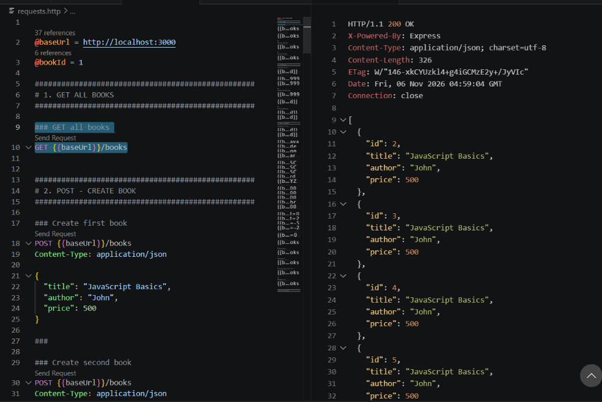

### 2. POST Create Book 1 (`POST /books`) — Status `201 Created`
Creates new book "JavaScript Basics" by John with price 500. Returns `201 Created` with generated `book_id: 7`.
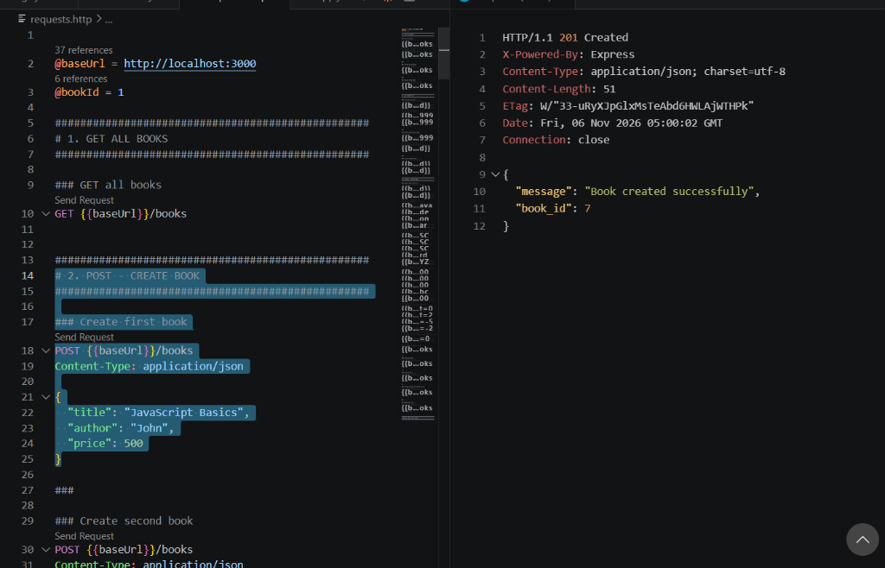

### 3. POST Create Book 2 (`POST /books`) — Status `201 Created`
Creates new book "Node.js Guide" by David with price 700. Returns `201 Created` with generated `book_id: 8`.
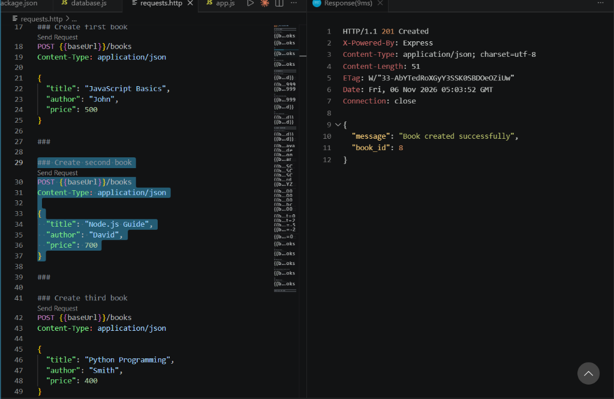

### 4. POST Create Book 3 (`POST /books`) — Status `201 Created`
Creates new book "Python Programming" by Smith with price 400. Returns `201 Created` with generated `book_id: 9`.
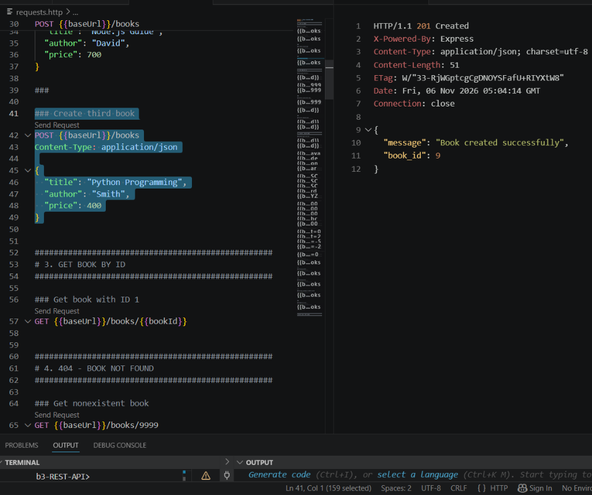

### 5. 404 Non-Existent Book (`GET /books/9999`) — Status `404 Not Found`
Querying an ID that does not exist returns HTTP 404 with a structured error payload.
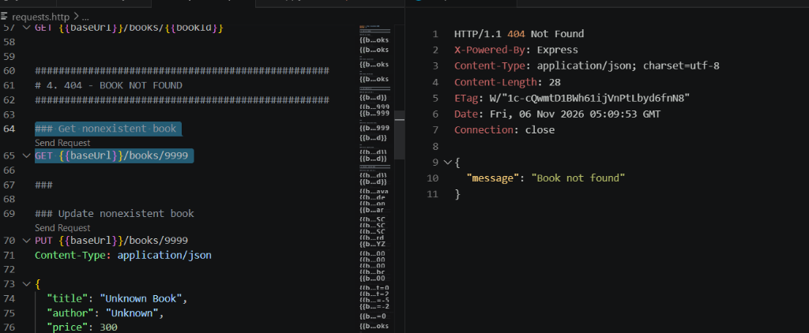

### 6. GET Book By ID (`GET /books/3`) — Status `200 OK`
Fetches a single book matching the path parameter ID.
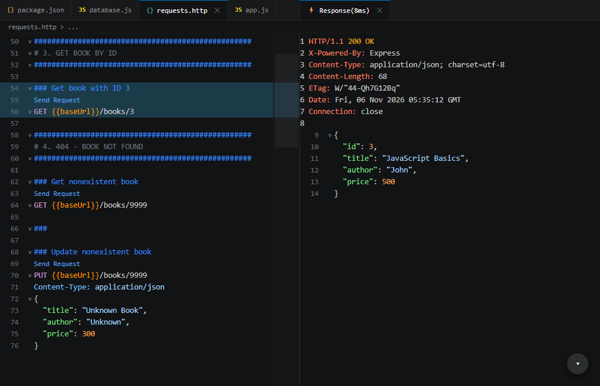

### 7. PUT Update Book (`PUT /books/3`) — Status `200 OK`
Modifies title and price of book with ID 3. Returns `200 OK` with confirmation message.
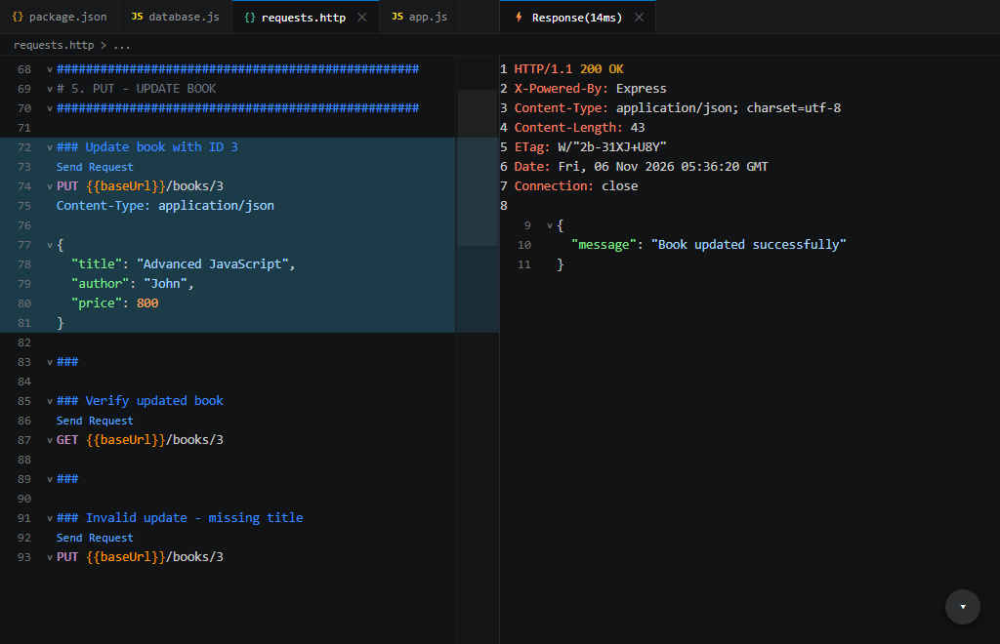

### 8. DELETE Book (`DELETE /books/3`) — Status `200 OK`
Removes book with ID 3 from the database. Returns `200 OK`.
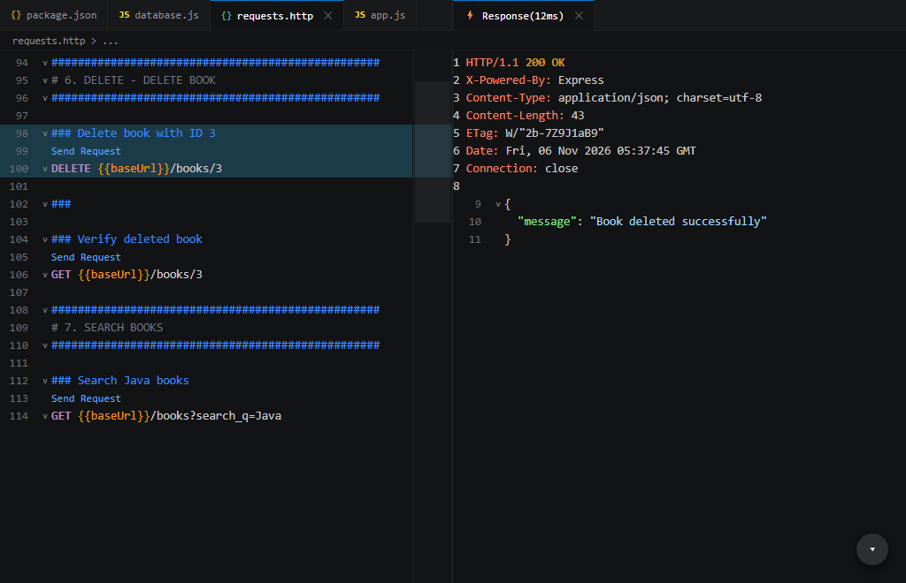

### 9. Search Books with LIKE (`GET /books?search_q=Node`) — Status `200 OK`
Filters books by partial title match using SQLite `LIKE ?` parameterized query.
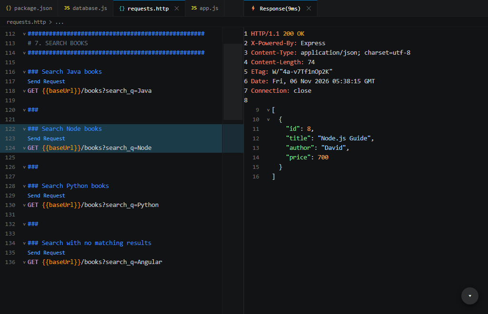

### 10. Sort Books by Price Descending (`GET /books?order_by=price&order=DESC`) — Status `200 OK`
Sorts records by price in descending order.
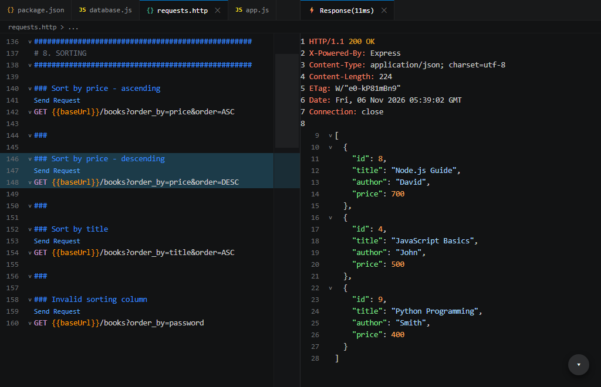

### 11. Price Range Filter (`GET /books?min_price=450&max_price=750`) — Status `200 OK`
Filters books within lower and upper price boundaries.
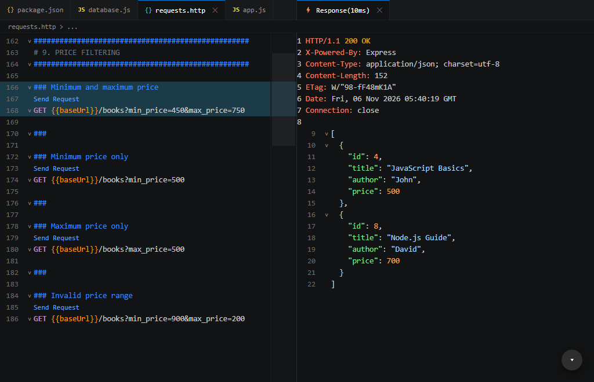

### 12. Pagination with Limit and Offset (`GET /books?limit=2&offset=0`) — Status `200 OK`
Returns the first page of results with 2 items.
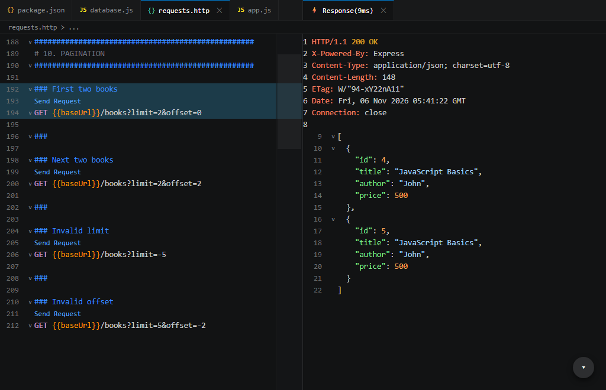

### 13. POST Validation Failure: Missing Title — Status `400 Bad Request`
Rejecting request payloads lacking required title field.
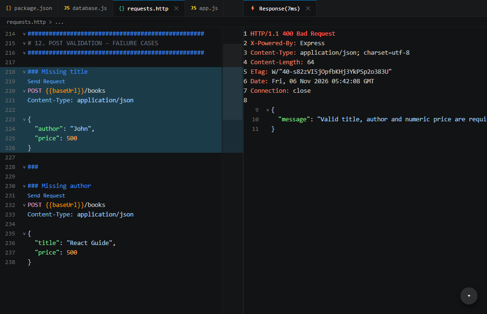

### 14. POST Validation Failure: Non-Numeric Price — Status `400 Bad Request`
Rejecting request payloads where price is supplied as a non-numeric string.
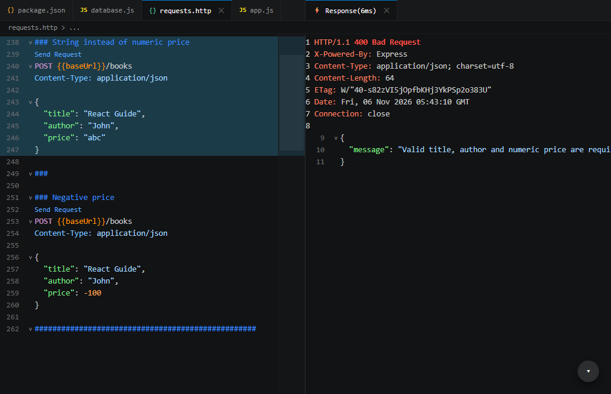

### 15. Validation Failure: Invalid Sort Column — Status `400 Bad Request`
Rejecting sort column inputs that are not present in the allowed column whitelist.
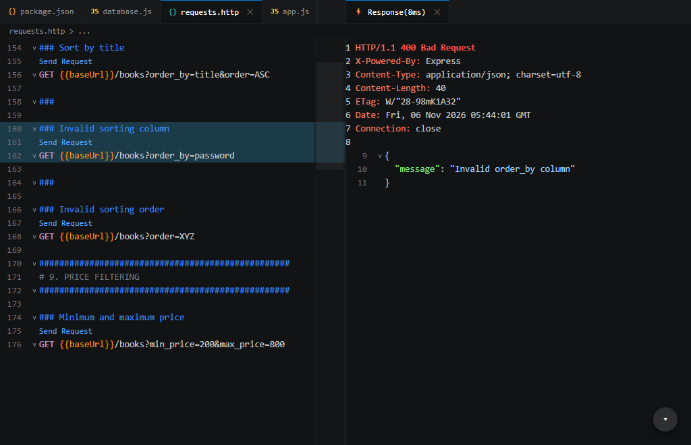

### 16. Debugging Fixes Verification — Server & Test Suite Pass
Terminal output demonstrating server startup and successful passage of all 14 test cases.
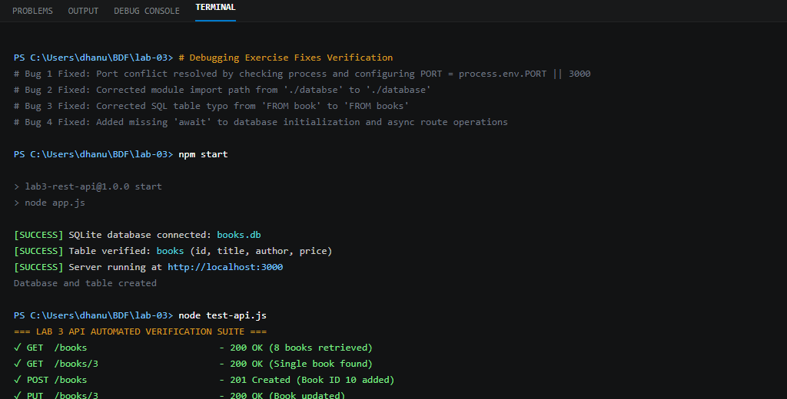

---

## Debugging Exercise Breakdown

The faculty handed out a broken version of the project containing 4 specific bugs. Here is how each bug was identified and resolved:

### Bug 1: Port Conflict (`EADDRINUSE`)
- **Symptoms**: Running `npm start` caused the Node.js process to crash immediately with the error:
  ```
  Error: listen EADDRINUSE: address already in use :::3000
  ```
- **Cause**: Another background process or previous Node instance was already bound to port 3000.
- **Fix**: Configured dynamic port handling using environment variable `process.env.PORT || 3000` and terminated the stale process holding the port using:
  ```bash
  Get-Process -Id (Get-NetTCPConnection -LocalPort 3000).OwningProcess | Stop-Process -Force
  ```

### Bug 2: Wrong Import Path
- **Symptoms**: The application failed on startup with:
  ```
  Cannot find module './databse'
  ```
- **Cause**: Typo in `app.js` importing `./databse` instead of `./database`.
- **Fix**: Corrected the import statement to `const initializeDB = require("./database");`.

### Bug 3: Table Name Typo (`no such table`)
- **Symptoms**: Incoming HTTP requests threw unhandled exceptions and returned HTTP 500:
  ```
  SQLITE_ERROR: no such table: book
  ```
- **Cause**: The SQL query in `app.js` used `SELECT * FROM book` (singular) while the schema initialized the table as `books` (plural).
- **Fix**: Standardized all SQL queries in `app.js` and `database.js` to reference `books`.

### Bug 4: Missing `await` Keyword
- **Symptoms**: Route handlers returned empty responses or crashed with `Promise { <pending> }` or `Cannot read properties of undefined`.
- **Cause**: `db.all(query, params)` and `initializeDB()` were called without `await`, causing Express to execute the next line before SQLite resolved the database promise.
- **Fix**: Prefixed all asynchronous database calls with `await` inside async route handlers:
  ```javascript
  const books = await db.all(query, params);
  ```

---

## Viva Questions & Answers

### 1. Query parameter vs path parameter?
- **Path Parameter**:
  - Part of the URL path itself, separated by slashes (e.g., `/books/2`).
  - Used to identify a **specific resource** or unique entity.
  - Mandatory: omitting it alters the route path completely.
  - Accessed in Express via `req.params` (e.g., `req.params.id`).
- **Query Parameter**:
  - Appended to the end of the URL following a question mark `?` and separated by ampersands `&` (e.g., `/books?search_q=Node&limit=5`).
  - Used to **filter, sort, search, or paginate** a collection without altering which resource is being targeted.
  - Optional: if omitted, the endpoint falls back to sensible defaults.
  - Accessed in Express via `req.query` (e.g., `req.query.search_q`).

### 2. What does stateless mean?
- In REST architecture, **statelessness** means that each HTTP request from a client to the server must contain all the information necessary for the server to understand and process the request.
- The server does not store any client session context or conversational state between requests in memory.
- Every request is completely self-contained and independent:
  - If a client requests `/books?offset=10`, the server does not remember that the client previously requested the first 10 books; the client explicitly provides the offset.
- **Benefits**: High scalability (requests can be handled by any server instance behind a load balancer), simplified server design, and high fault tolerance.

### 3. Which status code for bad input vs a missing record?
- **Bad Input → `400 Bad Request`**:
  - Used when the client sends malformed syntax, invalid query parameters, missing required body attributes (e.g., missing `title` or non-numeric `price`), or values that fail semantic business rules (e.g., `min_price > max_price`).
  - Indicates that the client made an error in the request payload or structure.
- **Missing Record → `404 Not Found`**:
  - Used when the request is syntactically valid and well-formed, but the specific resource identified by the URI does not exist in the database (e.g., `GET /books/9999`).
  - Indicates that the endpoint path was resolved, but no matching entity exists.

---

## Rules Compliance Summary

- **`.env` File**: Never committed or tracked in git; included in root `.gitignore`.
- **`node_modules`**: Excluded from repository tracking via `.gitignore`.
- **Plain Text Credentials**: No sensitive credentials or passwords stored or logged.
- **HTTP Status Codes**: Every route strictly enforces correct status codes (`200`, `201`, `400`, `404`, `500`).
- **Parameterized Queries**: All SQL statements utilize SQLite `?` placeholders (`db.all(query, params)` and `db.run(query, params)`), completely preventing SQL injection vulnerabilities.
